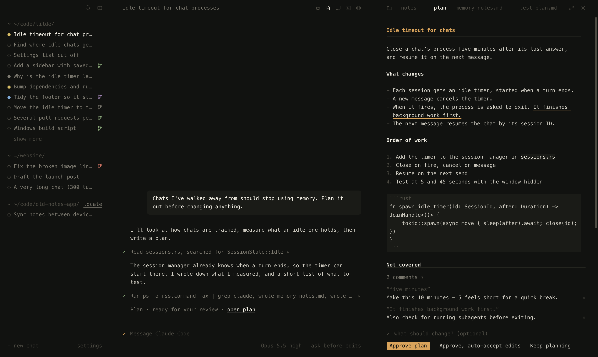

# Tilde

A lightweight, native desktop workspace for your coding agents.

Supports **Claude Code**, **Codex**, **Antigravity**, and **Cursor** using your existing CLI logins.

[Download for macOS](https://github.com/tailaiying32/tilde/releases/latest) · Windows coming soon.



## Why
Most desktop wrappers are heavy Electron shells that trap chat history, plans, and notes inside a single vendor, while gobbling up disk space and memory. Tilde puts a single UI in front of the CLIs already installed on your machine and owns the local context layer, so chats, docs, memory and preferences stay portable across every agent. Beyond that, it pairs a beautiful, terminal-inspired UI with thoughtful design choices and small quality-of-life features so your agents work with you, not against you.

---

## Features

### Agents & sessions
- **Four CLIs, existing logins:** Run **Claude Code**, **Codex**, **Antigravity**, and **Cursor** using the CLI subscriptions already signed in on your machine.
- **Mid-chat agent switching:** Switch to any agent from the model menu mid-thread. Tilde carries the conversation history forward so the next agent picks up where the previous one left off.
- **Model, effort, and native plan approval:** Per-chat model and effort controls plus native plan mode and plan approval cards (`Approve` / `Keep planning`) across all agents.
- **Message queueing and automatic idle pause:** Send follow-ups while an agent is still working (`queued`), and step away without wasting RAM. Idle sessions shut down their background process automatically and resume transparently on your next message.

### Context, docs, & memory
- **Live markdown side panel:** Plans and markdown docs open beside the chat in an editor that stays synced with your agent. Clicking markdown file links in chat or docs opens them directly as panel tabs.
- **Chat-scoped and project-scoped docs:** Each chat keeps its own notes and draft docs, and any doc can be promoted to shared project scope so every chat and worktree in the project sees it.
- **Cross-agent session recall:** Type `@` in the composer to attach any earlier chat in the project, or just ask. Every agent can search and read any prior sessions in the project.
- **Shared memory, preferences, and skills:** Project memory, global standing preferences, and imported skills follow your project automatically even if you move or rename its folder.
- **Agent-native composer menus:** Commands and skill triggers adapt to the active chat's agent, showing built-in commands alongside Tilde's own commands and imported skills.

### Inline comments
- **Comment directly on plans, docs, and replies:** Highlight any passage in a plan, side-panel markdown doc, or the latest agent reply (or press `Cmd+Enter` on a selection) to attach a comment right on the text.
- **Batched delivery with exact quotes:** Comments collect in a collapsible dock above the composer or plan approval bar and are sent together on your next turn with their exact quoted passages. No more copy-pasting and losing your train of thought while replying to your agent.

### Git worktrees & PRs
- **Isolated worktrees on demand:** When a task warrants its own branch, agents prompt via an in-app approval card to spin up a worktree instead of editing your main checkout.
- **Instant setup without disk bloat:** New and restored worktrees clone git-ignored build folders, packages, and local secrets from the main repo using copy-on-write, so builds stay fast without duplicating gigabytes on disk.
- **Live PR tracking:** Branch status glyphs in the sidebar and PR badges in the footer track open, draft, merged, and closed GitHub pull requests, even on tasks split across multiple PRs.
- **Automatic cleanup and 30-day trash:** Idle worktrees stow uncommitted changes into a hidden git ref after 14 days and restore cleanly on the next message. Merged PRs remove the worktree and branch automatically, keeping your disk clean and Tilde's footprint small.

### Embedded terminal & localhost browser
- **Project-scoped terminal:** Real login shell tabs shared across the project, with options to open tabs in the main checkout or the active chat's worktree. Agents can open new tabs (e.g., for dev servers) and read terminal output directly.
- **Localhost side-panel browser:** Preview local web apps right beside the chat with viewport resizing, an "open in default browser" button, and built-in agent inspection tools (navigate, read DOM, click, type, check console logs, run JS, and capture screenshots).

### Long runs & multitasking
- **Chat info view:** Dedicated side-panel view tracking context window usage, active task lists, background commands, and subagents.
- **Read-only side chat:** Open a quick tangent thread in the side panel to ask questions without interrupting or crowding an active run.
- **Keep-awake (caffeinate):** Toggle in the top bar (also available as an agent tool) to prevent sleep during long runs, automatically releasing when you return, when work finishes, or after two hours. 
- **Split plans into parallel chats:** Explicitly ask an agent to spin up separate chats for complex tasks. Each child chat gets its own isolated brief, inspects the codebase, and waits for your go-ahead before editing.

### Workspace & UI
- **Light native footprint:** Built with Tauri 2 instead of Electron so the app stays small on memory and responsive across long sessions.
- **Quiet Terminal interface:** A beautiful, terminal-inspired UI folds low frequency controls away so your workspace stays uncluttered.
- **Images as text tokens:** Pasted, dropped, or tool-returned images stay clean as `[image N]` tokens in chat and open in a full-space viewer (fit-to-window or actual pixels) on click.
- **Themes, icon, and layout controls:** 20 built-in themes, 3 font sizes, a customizable app icon, and a resizable side panel that drags smoothly into full-screen or collapses cleanly.

---

## Architecture

### Stack
- **Backend (`src-tauri/`):** Rust + Tauri 2, Tokio async runtime, bundled SQLite (`rusqlite`) for chat history and session state, `portable-pty` for terminal tabs, and Tauri child WebViews (`browser.rs`) for the localhost browser.
- **Frontend (`src/`):** Svelte 5 + TypeScript, CodeMirror 6 for live markdown docs/plans, `xterm.js` for embedded terminals, `markdown-it` + `highlight.js` for chat rendering.
- **Landing page (`site/`):** Standalone Vite + Svelte build (`vite.site.config.ts`) sharing only `src/app.css`, `src/lib/themeData.ts`, and `src/lib/appIcon.ts`.

### Agent drivers (`src-tauri/src/agent/`)
Tilde spawns the real CLI binaries already authenticated on your machine—no proxy, no API-key intermediary, and no custom prompt wrappers:

- **Claude Code** (`claude_code.rs`): bidirectional streaming JSON over stdin/stdout with session resume and live model/effort control requests.
- **Codex** (`codex.rs`): Codex CLI app-server protocol.
- **Antigravity & Cursor** (`acp.rs`, `antigravity.rs`, `cursor.rs`): newline-delimited JSON-RPC 2.0 over ACP (`agy acp` / `agent acp`).

Idle agent subprocesses are shut down automatically after inactivity so background chats hold zero agent process memory; the next user message resumes the session transparently by session ID.

### Built-in MCP bridge (`mcp_http.rs`)
Workspace capabilities—earlier chat search/read, localhost browser control, terminal tab reads, side panel navigation, worktree prompts, multi-chat splitting, and keep-awake—are exposed over local MCP servers. Every supported agent receives the same tool surface natively without modifying the underlying agent.

### Local storage (`~/.tilde/`)
Everything Tilde keeps for you lives on disk as plain files (tracked per project, resilient to moving or renaming project directories):

```text
~/.tilde/
├── preferences.md          # global standing instructions read by every agent
├── skills/                 # imported skills shared across agents
└── projects/
    └── <project>/
        ├── chats/          # per-chat notes and chat-scoped docs
        ├── docs/           # shared project docs across all chats & worktrees
        └── memory/         # shared project memory index and notes
```

---

## Requirements

- macOS (Apple Silicon)
- At least one supported CLI installed and signed in (`claude`, `codex`, `agy`, or `cursor`)

## Developing locally

Requires Node.js and a Rust toolchain.

```bash
npm install
npm run tauri dev      # run the desktop app
npm run dev            # frontend dev server (visit /preview.html for sample-data UI preview)
npm run dev:site       # landing page dev server on http://127.0.0.1:1430
npm run check          # Svelte + TypeScript checks
npm run build:site     # build site/dist for Vercel
```

## License

See [LICENSE](LICENSE).
